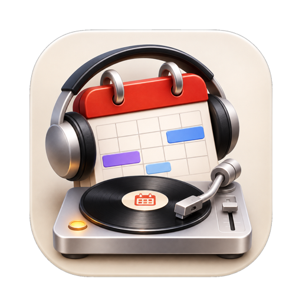

<p align="center">
  
</p>

<h1 align="center">DJ Agenda</h1>

A macOS menu bar app that turns Spotify into a radio station that knows your calendar.

In the run-up to your next meeting, a DJ talks over the end of each song: a quick back-announce,
a joke about the track or the meeting, and a countdown ("Nog vijf minuten tot de weekly!").
When the meeting starts, the DJ tells you it's time to go and pauses the music.

- **Spotify on your Mac** (via AppleScript) or **Spotify Connect on a Sonos** (local UPnP plus the
  Sonos audio-clip API, which ducks the music by itself). In "auto" mode the app picks whichever
  is playing.
- **Text** by Mistral Large (default), Claude, the on-device Apple model, or fixed phrases. Every
  generated line is checked against the calendar data, so the DJ can't invent times.
- **Voice** by Voxtral TTS through the Mistral API (default), Voxtral running locally with MLX,
  or the macOS system voice.
- **Dutch or English.** The DJ speaks either language; the interface is in English.
- **Smart timing.** The DJ does not talk when nothing is playing. If the meeting starts within two
  minutes of the current song's end, no new song starts. Travel time from Calendar.app becomes a
  "time to leave" announcement.

## Download

Grab the latest `DJAgenda-<version>.dmg` from
[Releases](https://github.com/rickpastoor/dj-agenda/releases/latest), open it and drag
**DJ Agenda** to **Applications**. The app is signed and notarized. It needs macOS 15+ on Apple
Silicon.

## Requirements

- macOS 15 or later on Apple Silicon (macOS 26 for the Apple model), Xcode 27 (tested with 27.2)
- A [Mistral API key](https://console.mistral.ai/api-keys) for the default text and voice. Without
  a key the app falls back to the local voice and fixed phrases.

## Build

```sh
xcodebuild -downloadComponent MetalToolchain   # once, needed by MLX
xcodebuild -project DJAgenda.xcodeproj -scheme DJAgenda -derivedDataPath build build
open build/Build/Products/Debug/DJAgenda.app
```

- **Trust the plug-in.** The first time, open the project in Xcode and click **Trust & Enable** for
  the `CudaBuild` plug-in of mlx-swift.
- **Signing.** The app is signed ad hoc by default. To use your own team, create
  `Signing.local.xcconfig` with `CODE_SIGN_IDENTITY` and `DEVELOPMENT_TEAM` (see
  `Signing.xcconfig`).

On first launch macOS asks for access to your calendars, permission to control Spotify, and
access to the local network (for Sonos). Paste your API key under **Settings → API Keys**.

Run the tests with:

```sh
xcodebuild -project DJAgenda.xcodeproj -scheme DJAgenda -derivedDataPath build test
```

Developer notes (in Dutch) are in [CLAUDE.md](CLAUDE.md).

## API keys

- **Where they live.** Paste a key under **Settings → API Keys** and it goes into your macOS
  Keychain, not into the app's settings. You can also set `MISTRAL_API_KEY` or
  `ANTHROPIC_API_KEY` in the environment. The app never logs a key.
- **Set a spend limit first.** Before you paste a key, set a low monthly spend limit and a usage
  alert in the [Mistral](https://console.mistral.ai) or [Anthropic](https://console.anthropic.com)
  console. DJ Agenda uses very little (a few short texts and voice clips per meeting), but a limit
  protects you if a key ever leaks.
- **Never commit a key.** If you build from source and put a key in a file, keep that file out of
  git (add it to `.gitignore`). Deleting a committed key later does not remove it from the git
  history: revoke it in the console and create a new one.

## Privacy

With Mistral or Claude enabled, the title, description and attendee first names of your next
meeting are sent to that API to write the DJ's line. Choose **On-device model (Apple)** or **Fixed phrases**
to keep everything on your Mac.

## License

MIT, see [LICENSE](LICENSE). The voice reference clips in `DJAgenda/Resources` were made with
Voxtral and are CC BY-NC 4.0 (non-commercial).
